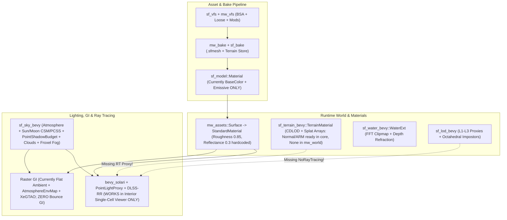

# Next-Gen Visual Fidelity Plan: PBR Materials, Global Illumination & Ray Tracing

> [!IMPORTANT]
> **Context for Executing Agents**: Read **Section 1 (Workspace Laws)** and **Section 2 (Current Baseline)** completely before editing any file. Several pieces of hardware ray tracing (`bevy_solari`), DLSS Ray Reconstruction (`sf_dlss`), and terrain PBR texture arrays **already exist** in this repository—you must extend them rather than re-inventing them, and you must strictly obey the `superfargoth` vs `bevyrrowind` crate split and GPL licensing rules.

---

## 1. Mandatory Workspace Laws & Invariants

Any agent executing tasks from this plan **must** follow these repository invariants ([ARCHITECTURE.md](file:///D:/Gamedev/Bevyrrowind/superfargoth/docs/ARCHITECTURE.md), [build-perf.md](file:///D:/Gamedev/Bevyrrowind/superfargoth/docs/build-perf.md), [world-coordinates.md](file:///D:/Gamedev/Bevyrrowind/superfargoth/docs/specs/world-coordinates.md)):

1. **Engine Baseline**: Bevy `0.20.0`, `wgpu` `30.0.1`, Rust `1.90` (Edition 2024).
2. **Strict Crate Layering**:
   - **`superfargoth/crates/sf_*` (Bevy-Free Framework Cores)**: Pure Rust data structures, codecs, math, and offline bake steps. **NEVER** add `bevy_*` dependencies or Morrowind-specific concepts/names (`nif`, `esm`, `tes3`, `mw_*`) here.
   - **`superfargoth/crates/sf_*_bevy` (Framework Bevy Glue)**: Thin Bevy plugins, render passes, `.wesl` shaders, and asset loaders. Depend **only** on minimal `bevy_*` sub-crates (`default-features = false`) + `workspace-hack`—never on the umbrella `bevy` crate.
   - **`bevyrrowind/crates/mw_*` & `mw_*_bevy` (Game Adapters)**: Morrowind VFS/BSA/NIF/ESM translation (`mw_*` Bevy-free, `mw_*_bevy` Bevy plugins).
   - **`bevyrrowind/apps/bevyrrowind` (Thin Binary)**: CLI parsing and plugin wiring only ([main.rs](file:///D:/Gamedev/Bevyrrowind/bevyrrowind/apps/bevyrrowind/src/main.rs)). Never put rendering or asset logic in `main.rs`.
3. **Dependency Unification (`cargo hakari`)**: Whenever you add or change dependencies/features in any `Cargo.toml`, run `cargo hakari generate` so `superfargoth/crates/workspace-hack` stays synchronized.
4. **Lints & Safety**: `unsafe_code = "forbid"` is enforced workspace-wide ([Cargo.toml](file:///D:/Gamedev/Bevyrrowind/Cargo.toml#L271-L288)), along with pedantic `clippy` lints.
5. **GPL-3.0-or-later & Proprietary SDK Isolation**: Never link NVIDIA NGX or proprietary vendor code into the workspace. DLSS uses the clean-room facade in `superfargoth/vendor/dlss_wgpu` and loads `sf_dlss.dll` dynamically from `superfargoth/plugins/sf_dlss` at runtime, falling back cleanly to TAA if absent.
6. **Floating-Origin Coordinates (`big_space`)**:
   - World positions are `sf_coords::WorldPos { cell: IVec3, local: Vec3 }` (`256.0 m` grid cells).
   - `GlobalTransform` is **floating-origin-relative**—never persist it or compare it across frames as world-absolute.
   - Whenever the floating-origin cell shifts, temporal buffers (`SolariLighting.reset = true`, `TemporalHistory { reset: true }`) **must** reset on that frame.
7. **Vendored Engine Patches**: `bevy_core_pipeline`, `bevy_pbr`, `bevy_render`, `big_space`, and `dlss_wgpu` are already vendored under `superfargoth/vendor/` and wired via `[patch.crates-io]` in [Cargo.toml](file:///D:/Gamedev/Bevyrrowind/Cargo.toml#L254-L270). If `bevy_solari` requires a shader/validation fix, vendor `bevy_solari` `0.20.0` into `superfargoth/vendor/bevy_solari` using the exact same pattern.

---

## 2. Current Rendering Pipeline Audit (What Exists vs. What Is Missing)



### Summary of Existing Capabilities & Gaps

| Subsystem | Already Implemented Today | Critical Gaps to Solve |
| :--- | :--- | :--- |
| **Model PBR** | Diffuse + cutout/blend alpha + glow/emissive in [mw_assets/src/lib.rs](file:///D:/Gamedev/Bevyrrowind/bevyrrowind/crates/mw_assets/src/lib.rs#L376-L423). Alternate extension lookup (`["ktx2", "dds", "png"]`). | `sf_model::Material` lacks normal/ORM/height slots. `is_srgb = true` hardcoded for all model textures. Tangents omitted on raster meshes. Zero PBR mod sidecar discovery (`_n`, `_nh`, `_orm`, `_pbr`). |
| **Terrain PBR** | [sf_terrain/src/bake.rs](file:///D:/Gamedev/Bevyrrowind/superfargoth/crates/sf_terrain/src/bake.rs#L204-L211) & `terrain.wesl` **already** support `albedo_height` + `normal_ao_roughness` texture arrays and Mishkinis height blending! | [mw_world/src/terrain.rs](file:///D:/Gamedev/Bevyrrowind/bevyrrowind/crates/mw_world/src/terrain.rs#L238-L246) hardcodes `normal: None` and `arm: None`, falling back to flat normals and `0.9` roughness. |
| **Solari Ray Tracing** | Working end-to-end in single-cell interior viewer ([view.rs](file:///D:/Gamedev/Bevyrrowind/bevyrrowind/crates/mw_viewers_bevy/src/view.rs#L170)) via [sf_sky_bevy/src/path.rs](file:///D:/Gamedev/Bevyrrowind/superfargoth/crates/sf_sky_bevy/src/path.rs), emissive `PointLightProxy` spheres ([proxy.rs](file:///D:/Gamedev/Bevyrrowind/superfargoth/crates/sf_sky_bevy/src/proxy.rs)), and DLSS-RR ([upscale.rs](file:///D:/Gamedev/Bevyrrowind/superfargoth/crates/sf_sky_bevy/src/upscale.rs)). | **Streamed exteriors are completely untraced**: `main.rs` diverts `--rt` to single-cell; `sf_world_bevy` doesn't load `ray_tracing_lod`; `sf_lod_bevy` lacks `NoRayTracing`; CDLOD terrain has no RT BLAS proxy; `SpotLight`s unproxied; lantern cages self-occlude; atmosphere double-attenuation bug. |
| **Raster GI & Reflections** | `Hdr` camera, `AtmosphereEnvironmentMapLight` (8-frame throttled in [env_refresh.rs](file:///D:/Gamedev/Bevyrrowind/superfargoth/crates/sf_sky_bevy/src/env_refresh.rs)), `ScreenSpaceAmbientOcclusion` (XeGTAO), `ContactShadows`, 3D froxel fog. | **Zero diffuse bounce GI** in interiors (flat 300-nit ambient) and unoccluded sky cubemap leaks under exterior overhangs. No `IrradianceVolume` / `LightProbe` baker or runtime. No `ScreenSpaceReflections` (SSR) on shiny PBR surfaces or water. |

---

## 3. Execution Roadmap Overview

Execute these three tracks **in order**. Track 1 (PBR) is prerequisite because both Solari Ray Tracing (Track 2) and Raster GI/Reflections (Track 3) evaluate `StandardMaterial` normals, roughness, metallic, and occlusion.

- **Track 1: End-to-End PBR Materials & Morrowind Texture Pack Pipeline** (Phases 1A → 1D)
- **Track 2: Full-World Solari Hardware Ray Tracing (Exteriors + Interiors)** (Phases 2A → 2D)
- **Track 3: Next-Gen Raster GI & Reflections (Baked Probes + SSR + SSGI)** (Phases 3A → 3C)

---

## 4. Track 1 — End-to-End PBR Materials & Texture Pipeline

### Phase 1A: Extend `sf_model::Material` & Always Provide Vertex Tangents

**Goal**: Promote PBR material channels to first-class cooked model fields and ensure every mesh with normal/parallax maps has MikkTSpace tangents.

1. **Update `sf_model::Material` ([superfargoth/crates/sf_model/src/lib.rs](file:///D:/Gamedev/Bevyrrowind/superfargoth/crates/sf_model/src/lib.rs#L192-L204))**:
   Add fields (and bump the `.sfmesh` binary format schema/version in `sf_model`'s codec + `MeshCookStep` version so stale bake caches invalidate cleanly):
   ```rust
   pub struct Material {
       pub name: String,
       pub base_color_texture: Option<String>,
       pub normal_texture: Option<String>,
       /// glTF convention: G = perceptual roughness, B = metallic.
       pub metallic_roughness_texture: Option<String>,
       /// R = ambient occlusion (may point to the same `_orm` texture as `metallic_roughness_texture`).
       pub occlusion_texture: Option<String>,
       /// R = grayscale height/depth for Parallax Occlusion / Relief Mapping.
       pub height_texture: Option<String>,
       pub base_color: [f32; 4],
       pub emissive: [f32; 3],
       pub metallic: f32,              // default: 0.0 (1.0 when metallic_roughness_texture is Some)
       pub perceptual_roughness: f32,  // default: 0.85 (1.0 when metallic_roughness_texture is Some)
       pub reflectance: f32,           // default: 0.3  (0.5 dielectric standard when PBR pack is active)
       pub parallax_depth_scale: f32,  // default: 0.0  (e.g. 0.03 when height_texture is Some)
       /// True for DirectX-convention (Y-) normal maps unless pre-flipped during bake.
       pub flip_normal_map_y: bool,
       pub alpha: AlphaMode,
       pub double_sided: bool,
       pub unlit: bool,
       pub extras: BTreeMap<String, String>,
   }
   ```
2. **Update glTF Importer ([superfargoth/crates/sf_model/src/gltf_import.rs](file:///D:/Gamedev/Bevyrrowind/superfargoth/crates/sf_model/src/gltf_import.rs#L203-L228))**:
   Populate `metallic`, `perceptual_roughness`, `normal_texture`, `metallic_roughness_texture`, and `occlusion_texture` directly instead of writing stringified floats to `extras`.
3. **Generate `Mesh::ATTRIBUTE_TANGENT` on Raster Meshes**:
   - In [sf_model_bevy/src/loader.rs](file:///D:/Gamedev/Bevyrrowind/superfargoth/crates/sf_model_bevy/src/loader.rs#L228-L310):Currently `mesh.generate_tangents()` is only called in `submesh_to_ray_tracing_mesh` (line 304). Call `let _ = mesh.generate_tangents();` on standard raster submeshes as well (at minimum LOD0 and LOD1, or bake tangents offline in `sf_model` to save load-time CPU).
   - In [mw_assets/src/lib.rs](file:///D:/Gamedev/Bevyrrowind/bevyrrowind/crates/mw_assets/src/lib.rs#L283-L298) (`bevy_mesh`): Call `let _ = mesh.generate_tangents();` when `UV_0` and `NORMAL` attributes are present so runtime NIFs also render normal and parallax maps properly.

> [!WARNING]
> **Silent Failure Trap**: In [pbr_material.rs](file:///D:/Gamedev/Bevyrrowind/superfargoth/vendor/bevy_pbr/src/pbr_material.rs#L164-L168), Bevy **multiplies** `StandardMaterial.metallic` and `perceptual_roughness` against `metallic_roughness_texture`! If `metallic` is left at `0.0` when `metallic_roughness_texture` is `Some(...)`, **all metalness will be multiplied by zero and vanish!** Whenever a metallic-roughness texture is bound, set scalar `metallic: 1.0` and `perceptual_roughness: 1.0` (unless overridden by a `.mat.ron` factor).

---

### Phase 1B: Linear Texture Loading & Morrowind PBR Sidecar Discovery

**Goal**: Support drop-in Morrowind / OpenMW / MGE XE PBR texture mods and custom `.mat.ron` material sidecars across both cooked and runtime models.

1. **Fix `is_srgb` Color Space Bug in [mw_assets/src/lib.rs](file:///D:/Gamedev/Bevyrrowind/bevyrrowind/crates/mw_assets/src/lib.rs#L436-L450)**:
   - Currently `image_settings_clamped` hardcodes `settings.is_srgb = true`.
   - Parameterize it: `pub fn image_settings(clamp: [bool; 2], is_srgb: bool) -> impl Fn(&mut ImageLoaderSettings)`.
   - **Rule**:
     - `base_color_texture`, `emissive_texture` → `is_srgb = true`
     - `normal_map_texture`, `metallic_roughness_texture`, `occlusion_texture`, `depth_map` → **`is_srgb = false`**! (Loading a normal map with `is_srgb = true` warps neutral `0.5` normals to `0.214`, breaking all lighting.)
   - Also enable **anisotropic filtering** (`anisotropy_clamp = 8` or `16` on `ImageSamplerDescriptor` when `address_mode` is `Repeat` on High/Ultra settings) so cobblestones, terrain, and walls stay crisp at grazing angles.

2. **Implement PBR Companion Texture Resolver (`mw_assets::pbr` / `mw_bake::pbr`)**:
   Given a base diffuse virtual path `textures/foo.dds` (or `foo.tga`), probe the `sf_vfs::Vfs` using `TEXTURE_ALTERNATES` (`["ktx2", "dds", "png"]`) in this priority order:

   | Discovered Companion File(s) | Convention | Mapping to `sf_model::Material` / `StandardMaterial` |
   | :--- | :--- | :--- |
   | `textures/foo.mat.ron` | Explicit Bevyrrowind sidecar | Full override of textures, `metallic`, `roughness`, `reflectance`, `parallax_depth_scale`, `diffuse_transmission`, `flip_normal_map_y`. |
   | `foo_orm.{ktx2,dds,png}` | glTF ORM (`R=AO, G=Rough, B=Metal`) | **Zero-copy**: bind the **same** linear `Handle<Image>` to both `occlusion_texture` and `metallic_roughness_texture`! |
   | `foo_mr.{ktx2,dds,png}` + optional `foo_ao` | glTF MR (`G=Rough, B=Metal`) | `metallic_roughness_texture` (+ `occlusion_texture`). |
   | `foo_pbr.{ktx2,dds,png}` | OpenMW PBR (`R=Metal, G=Rough, B=AO` or ORM) | Normalize during `mw_bake` into `_orm` `.ktx2` (swizzling `R <-> B` if OpenMW pack profile is set in mod `meta.toml`). |
   | `foo_nh.{ktx2,dds,png}` or `textures/normals/foo_nh.*` | Morrowind / OpenMW Normal + Height in Alpha (DirectX `Y-`) | At `mw_bake`: split RGB → `normal_texture` (flip G so `flip_normal_map_y = false`) and Alpha → `R8Unorm` `height_texture` (`depth_map`). At runtime (unbaked loose DDS): bind to `normal_map_texture` with `StandardMaterial.flip_normal_map_y = true`. |
   | `foo_n.{ktx2,dds,png}` or `textures/normals/foo_n.*` | DirectX Tangent Normal (`Y-`) | Bind linear `normal_map_texture` + `flip_normal_map_y: true` (unless pre-flipped at bake). |
   | `foo_h.{ktx2,dds,png}` | Grayscale Height / Displacement | Bind linear `depth_map` + `parallax_depth_scale: 0.03`, `parallax_mapping_method: ParallaxMappingMethod::Relief { max_steps: 16 }` on LOD0 ONLY! |
   | `foo_spec` / `foo_s.{ktx2,dds,png}` | Legacy MGE XE Specular/Gloss | Convert at `mw_bake` into `ORM` (`R=255, G = 255 - gloss, B = 0`). |

3. **Wire `Surface::to_material` ([mw_assets/src/lib.rs](file:///D:/Gamedev/Bevyrrowind/bevyrrowind/crates/mw_assets/src/lib.rs#L376-L423)) and `cooked::surface` ([mw_assets/src/cooked.rs](file:///D:/Gamedev/Bevyrrowind/bevyrrowind/crates/mw_assets/src/cooked.rs#L235-L314))**:
   - Map all resolved PBR slots onto `StandardMaterial`:
     - `normal_map_texture`, `flip_normal_map_y`
     - `metallic_roughness_texture`, `metallic`, `perceptual_roughness`
     - `occlusion_texture`
     - `depth_map`, `parallax_depth_scale`, `parallax_mapping_method`, `max_parallax_layer_count: 16.0` (**LOD0 only**—strip `depth_map` on LOD1+ in `CookedMaterials` to save fragment cost at distance).
   - Fallback when **no** PBR companion exists: keep calibrated vanilla values (`perceptual_roughness: 0.85`, `reflectance: 0.3`, `metallic: 0.0`).

---

### Phase 1C: Enable Terrain PBR Normal, Height-Blend & Roughness/AO Maps

**Goal**: Unlock the PBR terrain array pipeline that already exists in `sf_terrain`!

1. **Inspect Existing Support**: [sf_terrain/src/bake.rs](file:///D:/Gamedev/Bevyrrowind/superfargoth/crates/sf_terrain/src/bake.rs#L204-L211) (`TerrainLayer`) and [sf_terrain_bevy/shaders/terrain.wesl](file:///D:/Gamedev/Bevyrrowind/superfargoth/crates/sf_terrain_bevy/shaders/terrain.wesl) **already** build and sample:
   - `albedo_height` (`Rgba8UnormSrgb`: RGB albedo + **Alpha height** for Mishkinis height-blended transitions between mud/cobblestone/ash/grass!)
   - `normal_ao_roughness` (`Rgba8Unorm`: RG tangent normal XY, B ambient occlusion, A perceptual roughness)
2. **Wire `mw_world::terrain` ([bevyrrowind/crates/mw_world/src/terrain.rs](file:///D:/Gamedev/Bevyrrowind/bevyrrowind/crates/mw_world/src/terrain.rs#L230-L246))**:
   - Currently `TerrainLayerDef` sets `normal: None, arm: None`.
   - Use the exact same companion-texture resolver from Phase 1B on each `LTEX` landscape texture path!
   - In [mw_bake/src/textures.rs](file:///D:/Gamedev/Bevyrrowind/bevyrrowind/crates/mw_bake/src/textures.rs) / terrain bake adapter:
     - If `_nh` or `_h` exists for a terrain `LTEX`, pack its height channel into the **Alpha** channel of `albedo_height` (and if missing, synthesize luminance/high-pass height so rocks protrude through ash/sand instead of soft linear alpha-blending!).
     - Flip DirectX `Y-` normal green channel (`G = 255 - G`) when feeding `sf_terrain::bake` so terrain normal maps match sun light direction.
     - Populate `arm` from `_orm` / `_pbr` / `_mr` so wet swamp mud has low roughness (`~0.25`) while dry ashlands have high roughness (`~0.92`).

---

### Phase 1D: Material Upgrade Polish (Foliage Translucency & Water/Glass)

- **Foliage Subsurface Translucency**: In `mw_assets`, detect cutout botanicals (`AlphaMode::Mask`, NIF paths under `meshes/f/` or flora records) and set `StandardMaterial.diffuse_transmission = 0.35` + attach `bevy_light::TransmittedShadowReceiver` on Near-ring flora so Bitter Coast / Grazelands leaves glow naturally when backlit by the sun.

**Track 1 Verification Gate**:
- Run `cargo test -p sf_model -p sf_terrain -p mw_assets -p mw_bake`.
- Place a test PBR texture set (`_n`, `_orm`, `_nh`) in `<user_data>/mods/pbr_test/textures/`, run `bevyrrowind bake`, and capture morning/noon/sunset screenshots in `Balmora` and `Seyda Neen` verifying grazing-angle specular, DirectX normal Y orientation (light from above illuminates top bevels, not bottom bevels!), and height-blended terrain splats.

---

## 5. Track 2 — Full-World Solari Hardware Ray Tracing (`bevy_solari` + DLSS-RR)

> [!NOTE]
> **How `bevy_solari` Works in Bevy 0.20**:
> - Requires inline ray queries (`EXPERIMENTAL_RAY_QUERY`) + bindless descriptor arrays (`RayTracingSupport` in [sf_sky_bevy/src/path.rs](file:///D:/Gamedev/Bevyrrowind/superfargoth/crates/sf_sky_bevy/src/path.rs)).
> - Renders primary visibility into a **Deferred G-Buffer** (`DefaultOpaqueRendererMethod::deferred()`, `Msaa::Off`), then runs ray-query compute passes over TLAS/BLAS (`RaytracingMesh3d`) evaluating **only `StandardMaterial`**, `DirectionalLight`, emissive meshes, and environment maps.
> - **Crucial constraints**:
>   1. Meshes in BLAS **must** be `PrimitiveTopology::TriangleList`, indexed (`U32`/`U16`), uncompressed, and contain `POSITION`, `NORMAL`, `UV_0`, and **`TANGENT`** (otherwise `bevy_solari` silently skips them!).
>   2. Custom shaders (`TerrainMaterial`, `WaterExt`, `ImpostorMaterial`) and `SkinnedMesh` **cannot** enter the BLAS directly.
>   3. `PointLight` / `SpotLight` are not traced natively—`sf_sky_bevy/src/proxy.rs` already solves `PointLight` via raster-invisible emissive `RaytracingMesh3d` spheres!

### Phase 2A: Connect Streamed Exteriors & Far-Field HLOD to Solari

**Goal**: Make `--rt` (and runtime Quality = Ultra RT toggle) work in the streamed exterior world (`mw_exterior_bevy`), not just the single-cell interior viewer.

1. **Decouple `--rt` from Single-Cell Viewer Redirect ([bevyrrowind/apps/bevyrrowind/src/main.rs](file:///D:/Gamedev/Bevyrrowind/bevyrrowind/apps/bevyrrowind/src/main.rs#L484))**:
   - In `wants_single_cell(&self)`, remove `|| self.rt` so `bevyrrowind view "Balmora" --rt` runs the full streamed world (`mw_exterior_bevy::exterior::run`).
2. **Enable `ray_tracing_lod` in Exterior Static Streaming (`sf_world_bevy` & `mw_exterior_bevy`)**:
   - Check how [mw_viewers_bevy/src/view.rs](file:///D:/Gamedev/Bevyrrowind/bevyrrowind/crates/mw_viewers_bevy/src/view.rs#L170) passes `ray_tracing_lod: Some(0)` to `mw_assets::cooked::load` ([cooked.rs](file:///D:/Gamedev/Bevyrrowind/bevyrrowind/crates/mw_assets/src/cooked.rs#L203-L213)).
   - Wire `ray_tracing_lod: Some(0)` into `mw_exterior_bevy`'s `StaticSpawner` / cooked template loader whenever `RayTracingSupport` is available and RT is enabled (or selectable at runtime).
   - Ensure LOD0 carries `RayTracingMesh(rt_mesh_handle)` and LOD1+ carry `NoRayTracing` (already handled by `cooked.rs:205-212` when `ray_tracing_lod` is `Some(0)`!).
3. **Bound TLAS Scope & Exclude Far-Field HLOD (`sf_lod_bevy` & `sf_sky_bevy/src/path.rs`)**:
   - In [sf_lod_bevy](file:///D:/Gamedev/Bevyrrowind/superfargoth/crates/sf_lod_bevy/src/lib.rs): Attach `sf_sky_bevy::NoRayTracing` (or a decoupled marker / filter) to **all** L1/L2/L3 HLOD `ProxyMaterial`, `ImpostorMaterial`, and `LightSpriteMaterial` entities so distant merged proxies never enter the TLAS or double-occlude Near-ring geometry.
   - In [sf_sky_bevy/src/path.rs](file:///D:/Gamedev/Bevyrrowind/superfargoth/crates/sf_sky_bevy/src/path.rs#L374-L415) (`mirror_meshes`):
     - Notice a subtle bug: if `mirror_meshes` only mirrors entities with `InheritedVisibility == true`, then when a Near-ring building switches from LOD0 to LOD1 at ~80m, LOD0 becomes hidden (`InheritedVisibility == false`) and LOD1 has `NoRayTracing`—meaning the building **vanishes from ray-traced shadows and GI bounce beyond 80m!**
     - **Fix**: For placed static models inside the active Near/Mid RT radius (e.g., `<= 300 m`), spawn a dedicated child or keep `RaytracingMesh3d` attached to a resident RT-only sub-entity (no `Mesh3d`, just `Transform` + `GlobalTransform` + `RaytracingMesh3d` + `MeshMaterial3d<StandardMaterial>`) while the cell is resident in Near/Mid ring, independent of LOD `VisibilityRange` dithering!
4. **Verify Floating-Origin Rebase Reset**:
   - Confirm that when `big_space` shifts the `FloatingOrigin` `CellCoord`, both `SolariLighting.reset = true` and `TemporalHistory { reset: true }` fire on the exact rebase frame so ReSTIR reservoirs and DLSS-RR history never smear across 256m cell shifts.

---

### Phase 2B: Resident Terrain Ray-Tracing Proxy (`sf_terrain_bevy`)

**Goal**: Put exterior terrain into Solari's TLAS with **zero** raster overhead so terrain casts ray-traced mountain/hill shadows and bounces warm ground GI onto buildings.

1. **Why**: `TerrainMaterial` displaces vertices on the GPU via CDLOD height clipmaps ([sf_terrain_bevy/src/lib.rs](file:///D:/Gamedev/Bevyrrowind/superfargoth/crates/sf_terrain_bevy/src/lib.rs#L6-L15)). Solari BLAS builders only read CPU/buffer vertex positions on `StandardMaterial` meshes.
2. **Implementation (`superfargoth/crates/sf_terrain_bevy/src/rt_proxy.rs`, gated behind `solari` feature on `sf_terrain_bevy`)**:
   - Watch resident tiles in `TerrainWorld` / `TerrainHeightsMap` within a configurable radius around `TerrainCamera` (e.g., 2–3 tile rings around camera).
   - On `AsyncComputeTaskPool`, generate one indexed `TriangleList` `Mesh` per resident tile (e.g., `65×65` or `129×129` grid at 2m–4m spacing, with skirt/stitched borders so rays don't leak between tiles):
     - Attributes: `ATTRIBUTE_POSITION`, `ATTRIBUTE_NORMAL` (central differences from heightmap), `ATTRIBUTE_UV_0` (`[0..1]` across tile), `ATTRIBUTE_TANGENT` (`[1.0, 0.0, 0.0, 1.0]`), `Indices::U32`, `RenderAssetUsages::RENDER_WORLD`.
   - Create a per-tile `StandardMaterial` whose `base_color_texture` is extracted from `BakedTerrain`'s baked macro-albedo for that tile (`perceptual_roughness: 0.9`, `metallic: 0.0`, `reflectance: 0.3`).
   - Spawn an entity positioned relative to `TerrainOrigin` carrying **`RaytracingMesh3d(mesh)` + `MeshMaterial3d<StandardMaterial>` and NO `Mesh3d`** (exact same raster-invisible pattern as [sf_sky_bevy/src/proxy.rs](file:///D:/Gamedev/Bevyrrowind/superfargoth/crates/sf_sky_bevy/src/proxy.rs)).
   - Result: Primary camera pixels still render full-resolution CDLOD height-blended PBR terrain via `TerrainMaterial` in the G-buffer/opaque pass, while secondary shadow & GI rays hit the terrain proxy!
   - **Important Check**: Verify `TerrainMaterial` writes to the **Deferred G-Buffer** (`terrain_prepass.wesl` must support `DEFERRED_PREPASS` output when `DefaultOpaqueRendererMethod::deferred()` is active!). Inspect `sf_terrain_bevy/shaders/terrain_prepass.wesl` and `terrain.wesl`: if `TerrainMaterial` currently runs forward-only, either add deferred G-buffer output in `terrain_prepass.wesl` (so Solari shades primary terrain pixels with full ray-traced GI + shadows!) or ensure forward fallback still receives shadows. **Writing G-buffer from `terrain_prepass.wesl` is the cleanest next-gen path** because Solari will then ray-trace direct sun shadows, lamp proxies, and multi-bounce GI directly onto the splatted PBR terrain!

---

### Phase 2C: Punctual Lights, Lantern Fixtures, SpotLights & Solari Bug Fixes

1. **Fix Lantern / Streetlamp Fixture Self-Occlusion (`mw_assets::lights` & `mw_bake`)**:
   - Many Morrowind lights (`light_de_streetlight_01`, `light_com_lantern_01`) place `AttachLight` *inside* an opaque/glass NIF mesh. In Solari, the `PointLightProxy` sphere sits inside that mesh, trapping all rays!
   - **Fix**: On models that contain an `AttachLight` node (or carried light models marked `self_lit` in [mw_assets/src/lib.rs](file:///D:/Gamedev/Bevyrrowind/bevyrrowind/crates/mw_assets/src/lib.rs#L73-L86)), tag enclosing glass/bulb submeshes (or submeshes within `r < 0.25 m` of `AttachLight`, matching `SHADOW_NEAR_Z = 0.25 m` in `lights.rs:112`) with `NoRayTracing`.
2. **Add `SpotLightProxy` ([superfargoth/crates/sf_sky_bevy/src/proxy.rs](file:///D:/Gamedev/Bevyrrowind/superfargoth/crates/sf_sky_bevy/src/proxy.rs))**:
   - Mirror `SpotLight`s into Solari by spawning two raster-invisible `RaytracingMesh3d` child meshes: an emissive disk facing `-Z` recessed inside a tiny matte-black (`base_color = BLACK, roughness = 1.0`) open cone/baffle whose opening angle matches `SpotLight.outer_angle`.
3. **Alpha-Cutout Handling (`DL-4`)**:
   - Until `bevy_solari` supports any-hit alpha-mask evaluation in BLAS ray queries, automatically attach `NoRayTracing` in `mw_assets` to `AlphaMode::Blend` and small decorative `AlphaMode::Mask` decals/rugs (so rug fringes in Census & Excise Office don't cast solid black rectangular RT shadows), while keeping solid tree trunks traced.
4. **Fix Known Solari Engine Bugs (Vendor `bevy_solari` `0.20.0` into `superfargoth/vendor/bevy_solari` if needed)**:
   - **Atmosphere Double-Attenuation ([sky-lighting.md](file:///D:/Gamedev/Bevyrrowind/superfargoth/docs/specs/sky-lighting.md))**: `SkyLight::ground_light` pre-attenuates `DirectionalLight.illuminance` by atmospheric transmittance, which darkens the `Atmosphere` sky LUT when shared with Solari. Separate sky-LUT sun extraterrestrial illuminance from Solari/ground attenuated illuminance (or un-attenuate inside the atmosphere pass).
   - **Denoiser-Off Validation Panic (`DL-5`)**: Fix the `sky_motion` bindgroup/texture validation panic when running `--rt --off denoiser` in interiors.
   - **Verify `FLIP_NORMAL_MAP_Y` in Solari Hit Shader**: Ensure `bevy_solari`'s bindless `StandardMaterial` hit evaluator honors `STANDARD_MATERIAL_FLAGS_FLIP_NORMAL_MAP_Y` (if not, add the 2-line Y-flip in vendored `bevy_solari` so runtime DirectX `_n.dds` maps match raster).

**Track 2 Verification Gate**:
- `bevyrrowind view "Census and Excise Office" --rt` (both with DLSS-RR and `--off denoiser` / ReSTIR): verify no `DL-5` panic, no black rug border (`DL-4`), warm bounce from PBR wood/plaster.
- `bevyrrowind view "Balmora" --rt --hour 17.5`: verify terrain + buildings + lanterns all trace in Solari, far-field HLOD doesn't double-render, and flying across 256m cell boundaries produces zero temporal ghosting.

---

## 6. Track 3 — Next-Gen Raster GI & Reflections (Non-RT / Hybrid Path)

Even when hardware ray tracing is unavailable (AMD/Intel mid-range GPUs, Steam Deck, or High preset) — and for **transparent/forward shaders like `WaterExt` and `SkinnedMesh` actors** — the engine needs indirect bounce GI, sky occlusion under overhangs, and specular reflections.

### Phase 3A: Offline Baked `IrradianceVolume` Probes per Cell (`sf_bake` + `mw_bake` + `mw_environment_bevy`)

**Goal**: Unpark `ROADMAP.md` Phase 4 Raster GI by baking Bevy 0.20 `IrradianceVolume` ambient-cube 3D textures per interior cell and per populated exterior cell.

1. **Create Bevy-Free GI Baker (`superfargoth/crates/sf_gi` or `sf_bake` step)**:
   - **Inputs**: Static cooked cell meshes (`sf_model` positions + indices + average material `base_color` / `emissive`), terrain heights/albedo (exteriors), and static `PointLight` placements.
   - **Raycaster**: Build a `parry3d` `Qbvh` over cell triangles (already in workspace `Cargo.toml`!).
   - **Probe Grid**:
     - **Interiors**: Compute tight AABB around static geometry, pad by `1.0 m`, subdivide at `1.5 m – 2.0 m` voxel resolution (clamp grid dimensions to `<= 64×64×32` per volume; subdivide large multi-hall interiors into multiple volumes). Push probe sample points slightly out of solid backfaces along surface normals so walls don't leak black interior texels.
     - **Exteriors (Town/Structure Cells Only)**: Only bake 256m exterior cells containing significant overhead/vertical statics (e.g., `> 15` architecture placements: Balmora, Vivec cantons, Ald'ruhn, forts). Bake **directional 6-face sky visibility (`[0..1]`) + 1-bounce neutral albedo transfer** from `z_terrain - 1m` to `z_max_building + 2m` at `4.0 m` horizontal / `2.0 m` vertical spacing.
   - **Bounce Solver**: Monte Carlo cosine-weighted hemisphere rays (`128–256` rays per probe × `2` diffuse bounces) on `rayon`. Pack into Bevy 0.20's `IrradianceVolume` 3D image layout: dimensions `(Wx, Wy, 6 * Wz)` (`Rgba16Float` or `Rgb9e5Ufloat` compressed into `sf_bake::Store`).
2. **Runtime Streaming & Weather Modulation (`sf_sky_bevy` + `mw_environment_bevy` + `sf_world_bevy`)**:
   - When `RenderPath::Raster` is active:
     - **Interiors**: Spawn `LightProbe` + `IrradianceVolume { voxels, intensity: 1.0 }` spanning the cell AABB, and drop the flat 300-nit `GlobalAmbientLight` down to a tiny safety floor (`~15 nits`) so rooms have deep shadows, warm torch bounce off stonework, and true indirect depth!
     - **Exteriors**: Stream per-cell `LightProbe` + `IrradianceVolume` in Near/Mid rings, updating `IrradianceVolume.intensity` continuously from `SkyCamera` ambient/sun illuminance so exterior alleys, bridges, and Vivec underworks naturally darken and take warm sandstone/velothi bounce!
   - **Critical Bevy 0.20 Caveat**: `LightProbe`s in Bevy 0.20 ignore `RenderLayers`. Always despawn or set `Visibility::Hidden` / remove `LightProbe` on inactive worldspaces during door transitions, and disable `IrradianceVolume` when switching to `RenderPath::RayTraced` (so Solari doesn't double-light scenes).

---

### Phase 3B: Deferred Raster + `ScreenSpaceReflections` (SSR) + Interior Reflection Probes

**Goal**: Give PBR metals, wet surfaces, Dwemer brass, glass armor, and water crisp specular reflections on the raster path.

1. **Enable `ScreenSpaceReflections` on High/Ultra Raster (`sf_sky_bevy` & `mw_exterior_bevy`)**:
   - High/Ultra raster presets enable `DefaultOpaqueRendererMethod::deferred()` (or opt-in per preset) + `ScreenSpaceReflectionsPlugin` + camera component `ScreenSpaceReflections::default()`.
   - Because TAA or DLSS Super Resolution (`sf_sky_bevy/src/upscale.rs`) is already active on High/Ultra, stochastic SSR rough reflections temporally accumulate cleanly.
2. **Fix Interior Specular Cubemaps (`mw_environment_bevy`)**:
   - Currently `AtmosphereEnvironmentMapLight` is attached to `SkyCamera` globally—meaning shiny PBR armor inside a dark cave or Velothi tomb would reflect **bright outdoor blue sky**!
   - In interior worldspaces (where sky is absent), disable `AtmosphereEnvironmentMapLight` on the camera and bind a cell-appropriate `EnvironmentMapLight` (generated at cell entry from the interior's baked `IrradianceVolume` average cube colors, or baked offline at `64²` per interior cell).
3. **Upgrade Water Reflections (`sf_water_bevy/shaders/water_material.wesl`)**:
   - `WaterExt` already binds pre-transparent `snapshot_color` (HDR) and `snapshot_depth` (`R32F`) for refraction!
   - Add a lightweight screen-space depth-buffer raymarch (`12–16` hierarchical/linear steps + binary refinement against `snapshot_depth` + `snapshot_color`) directly inside `water_material.wesl`, fading cleanly at screen edges and wave roughness to the `Atmosphere` sky cubemap! This works in **both** Raster and Solari modes (since water is rendered in the `Refractive` transparent band *after* Solari/opaque resolves into the main HDR target!).

---

### Phase 3C: Dynamic Screen-Space Diffuse GI & Bent Normals (Raster Ultra+)

**Goal**: Capture dynamic 1-bounce color bleeding and torch bounce (e.g., player's carried torch illuminating nearby walls and NPCs) that static `IrradianceVolume`s cannot bake.

- Extend the screen-space horizon loop (alongside Bevy's XeGTAO in `superfargoth/vendor/bevy_pbr` or as a half-res compute node in `sf_sky_bevy`) to implement **HBIL / Visibility-Bitmask SSGI**:
  - Inputs: `DepthPrepass`, `NormalPrepass` / Deferred G-buffer normals, `MotionVectorPrepass`, and **previous-frame HDR `ViewTarget`** (reprojected via motion vectors).
  - Compute bent normal + 1-bounce horizon indirect radiance at half resolution, temporally accumulate (`alpha = 0.08`, neighborhood-clamped), and inject into `StandardMaterial` ambient diffuse + align environment cubemap lookup along the **bent normal** instead of the raw surface normal.

---

## 7. Implementation Checklist & Task Breakdown for Sub-Agents

Each task below is scoped so a single coding session can complete, test, and commit it independently:

| ID | Milestone | Crates Touched | Est. Scope | Dependencies |
| :--- | :--- | :--- | :--- | :--- |
| **T1.1** | Add PBR fields to `sf_model::Material`, bump `.sfmesh` version, update `gltf_import`, enable raster `generate_tangents()` | `sf_model`, `sf_model_bevy`, `mw_assets` | Small | None |
| **T1.2** | Fix `is_srgb` linear loading, add anisotropy, implement VFS PBR sidecar resolver (`_orm`, `_mr`, `_n`, `_nh`, `_h`, `.mat.ron`) + `mw_bake` texture normalizer | `mw_assets`, `mw_bake` | Medium | T1.1 |
| **T1.3** | Wire `mw_world::terrain` & `mw_bake` to populate `sf_terrain` `normal`, `arm`, and height-in-alpha splat arrays | `mw_world`, `mw_bake`, `sf_terrain` | Small–Med | T1.2 |
| **T1.4** | Foliage `diffuse_transmission` + `TransmittedShadowReceiver` & LOD0 parallax cutoff | `mw_assets` | Small | T1.2 |
| **T2.1** | Enable Solari in exterior streaming (`main.rs`, `sf_world_bevy`, `mw_exterior_bevy`), tag `sf_lod_bevy` `NoRayTracing`, decouple RT residence from LOD0 dither | `bevyrrowind` bin, `mw_exterior_bevy`, `sf_lod_bevy`, `sf_sky_bevy` | Medium | T1.1 |
| **T2.2** | Build raster-invisible Terrain RT BLAS proxy (`sf_terrain_bevy::rt_proxy`) + verify/add `TerrainMaterial` deferred G-buffer prepass output | `sf_terrain_bevy` | Medium–Large | T2.1 |
| **T2.3** | Add `SpotLightProxy`, lantern cage `NoRayTracing` auto-tagging, decal cutout `NoRayTracing`, and fix Solari atmosphere double-attenuation & `DL-5` | `sf_sky_bevy`, `mw_assets`, `vendor/bevy_solari` | Medium | T2.1 |
| **T3.1** | Offline `IrradianceVolume` probe baker (interior bounce + exterior sky-visibility) using `parry3d` + `rayon`, plus runtime `LightProbe` cell streaming | `sf_bake` (or `sf_gi`), `mw_bake`, `mw_environment_bevy`, `sf_sky_bevy` | Large | T1.2 |
| **T3.2** | Enable `ScreenSpaceReflections` on High/Ultra raster, interior reflection cubemap isolation, and SSR raymarch in `water_material.wesl` | `sf_sky_bevy`, `mw_exterior_bevy`, `mw_environment_bevy`, `sf_water_bevy` | Medium | T1.2 |
| **T3.3** | Half-res temporal Screen-Space GI + Bent Normals pass for dynamic torch/local bounce on raster | `sf_sky_bevy` / `vendor/bevy_pbr` | Large | T3.2 |

---

## 8. Mandatory Verification Commands After Every Task

Any agent completing one of the tasks above **must** run these checks before reporting completion:

```powershell
# 1. Keep workspace-hack unified if any Cargo.toml changed
cargo hakari generate
cargo hakari verify

# 2. Enforce zero unsafe code, compile checks, and pedantic clippy rules
cargo clippy --workspace --all-targets

# 3. Run fast Bevy-free core unit tests first
cargo test -p sf_model -p sf_terrain -p sf_sky -p mw_world -p mw_bake

# 4. Re-bake cooked meshes/terrain/probes when bake schemas change
cargo run -p bevyrrowind -- bake

# 5. Automated ReadyGate visual regression screenshots (Raster vs RT)
cargo run -p bevyrrowind -- view "Census and Excise Office" --screenshot interior_raster.png
cargo run -p bevyrrowind -- view "Census and Excise Office" --rt --screenshot interior_rt.png
cargo run -p bevyrrowind -- view "Balmora" --hour 17.5 --quality ultra --screenshot balmora_raster.png
cargo run -p bevyrrowind -- view "Balmora" --hour 17.5 --rt --screenshot balmora_rt.png
```
